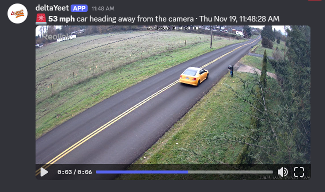

# Street Speed

Measure the speed of passing vehicles with an ordinary IP camera, and show the speeds in Home Assistant. Speeding vehicles can optionally trigger a Discord alert with a short video clip.

It runs as one Docker container. With a Google Coral Edge TPU it uses a few percent of one CPU core. It also runs without a Coral, on the CPU.



*An optional speeding alert in Discord, with a 6-second clip of the pass.*

> **Accuracy:** readings are estimates. Accuracy depends on how carefully you calibrate. On a well-calibrated camera, simulated tracks are recovered to within about 0.1 mph, and real readings are consistent. This is not a certified speed-measurement device: don't use it for enforcement. Check local rules before recording a public street.

## How it works

```
RTSP sub-stream (e.g. 640x360 @ 10 fps)
  -> motion gate (only the road area, so trees and animals don't wake the detector)
  -> vehicle detector (SSDLite MobileDet, COCO: car/truck/bus/motorcycle) on the Coral or CPU
  -> tracker (matches detections frame to frame by distance on the road, in metres)
  -> ground point of each box -> lens correction + homography -> metres along the road
  -> robust straight-line fit of distance vs. frame timestamp = speed
  -> Home Assistant sensors + hourly/daily statistics; optional Discord clip for fast vehicles
```

- **Calibration** maps camera pixels to road coordinates. You measure a few landmarks along the road (for example mailboxes, driveway edges and posts) and click them on a camera frame, along with the pavement edges. `tools/calibrate.py` then fits a homography plus a one-term radial lens correction. That correction matters for wide-angle cameras: without it, straight road edges bow and distances come out wrong.
- **Timing** uses the stream's own frame timestamps, not the time frames arrive, so network jitter doesn't affect speeds.
- **Quality guards** reject a track instead of guessing:
  - too few points, or too short a distance covered;
  - a poor fit;
  - the vehicle seen only far away, where a pixel is about a metre of road;
  - the camera has moved (image shift against a reference frame);
  - for PTZ cameras, the camera is not at its calibrated position.

  Rejections are stored with a reason in `data/speeds.db`.
- **Watchdog:** USB Corals occasionally hang without raising an error. If no frame is processed for 60 s, the service exits and Docker restarts it.

## What you need

- An IP camera with RTSP and two streams: a low-resolution one for detection and a high-resolution one for calibration and clips. The camera should be fixed (or a PTZ with a stable home position), looking along or diagonally across a straight stretch of road, with about 30–50 m visible.
- A Linux host with Docker on x86-64. The Coral runtime used here is x86-64 only; on ARM, build libedgetpu yourself.
- Optional: a Google Coral USB Accelerator (or M.2/PCIe). It's about 2.6x faster than one CPU core (43 ms against 114 ms per detection) and keeps the CPU load near zero.
- Home Assistant with a long-lived access token. No custom integration is needed: the service writes sensors through the REST API.
- A tape measure or measuring wheel.

## Setup

### 1. Get the code and models

```bash
git clone <this repository> street-speed && cd street-speed
./scripts/get_models.sh            # detector models from Google's Coral test data
cp config.example.json config.json
cp .env.example .env && chmod 600 .env
```

Fill in `.env`: the camera password, the HA token, your time zone, and optionally a Discord webhook.

In `config.json`, set `ha_url`, `speed_unit` (`mph` or `km/h`) and the `camera` section:

| Camera brand | `stream` (detection) | `clip_stream` (high-res) |
|---|---|---|
| Reolink | `h264Preview_01_sub` | `h264Preview_01_main` |
| Hikvision | `Streaming/Channels/102` | `Streaming/Channels/101` |
| Dahua / Amcrest | `cam/realmonitor?channel=1&subtype=1` | `cam/realmonitor?channel=1&subtype=0` |

For other brands, search "<model> RTSP URL". Test the URL with `ffplay rtsp://user:pass@ip:554/path`.

If you have no Coral, set `detector.device` to `cpu`.

### 2. Build

```bash
docker compose build
```

The image downloads the Edge TPU runtime (a community build of libedgetpu, because Google's Coral apt repository is gone). To use your own copy, put `libedgetpu.so.1` in `vendor/` before building.

### 3. Grab frames and check `frame_size`

```bash
mkdir -p data/calib
docker compose run --rm street-speed python3 tools/grab_frames.py /data/calib
```

This prints the size of each stream. Set `frame_size` in `config.json` to the sub-stream size, for example `[640, 360]`.

### 4. Measure the road

1. Choose a zero point beside the road, such as a mailbox. Measure along the road to 3–6 more landmarks spread across the camera's view. Count distances toward the camera as negative and away from it as positive. Include at least one close to the camera and one far away.
2. Measure the pavement width.
3. Landmarks don't need to be on the pavement. Only their distance along the road is used, so a post 2 m off the edge is fine. Click each one where it meets the ground.

### 5. Click the points

Open `tools/picker.html` in any browser (it works offline), then:

1. Open `data/calib/frame_main.jpg`.
2. Set the units and pavement width.
3. Mark:
   - each **landmark**, entering its measured distance;
   - 4–8 points along the **near edge**, the **far edge** and (optionally) the **centre line**;
   - the **road outline**: the area of pavement to measure in.
4. Click **Save points.json** and put the file in `data/calib/`, next to the image.

Scroll to zoom and right-drag (or Shift-drag) to pan. A magnifier follows the cursor for precise clicks.

### 6. Calibrate

```bash
docker compose run --rm -v "$PWD/config.json:/app/config.json" street-speed \
  python3 tools/calibrate.py /data/calib/points.json /app/config.json
```

The tool prints each landmark's measured and fitted distance. Errors under about 0.5 ft (15 cm) are good. Look at `data/calib/calib_check.jpg`: the drawn edges, centre line and distance grid should sit on the real road. If a landmark is off by a lot, re-check the measurement or the click.

Re-run this step whenever the camera is moved or re-aimed.

### 7. Run

```bash
docker compose up -d
docker compose logs -f
```

Every five minutes the log shows a stats line, and each measured vehicle gets a line like this:

```
track 7 n=18: 28.8 mph away (car) n=18 dur=1.82s span=26.8m rms=1.09m seen 07:53:36.80-07:53:38.62
```

To check detection and tracking alone, run `tools/tracktest.py`. It needs the road outline, but not the rest of the calibration.

### 8. Home Assistant

The service creates these entities, re-posting them every minute:

| Entity | What it is |
|---|---|
| `sensor.street_speed_last_vehicle` | Last measured speed. Attributes: `direction` (`away`/`toward` the camera), `vehicle`, `measured_at` |
| `sensor.street_speed_avg_this_hour`, `sensor.street_speed_avg_today` | Average speed (today also has `min` and `max`) |
| `sensor.street_speed_max_today`, `_max_this_week`, `_max_this_month` | Top speed, with when, direction and vehicle. Weeks start on Monday |
| `sensor.street_speed_measured_today` | Number of vehicles measured |
| `street_speed:avg_speed_hourly`, `street_speed:avg_speed_daily` | Long-term statistics (for statistics-graph cards) |

Sensors set through the REST API show as unavailable after an HA restart until the service's next update, within a minute.

For a ready-made view, open your dashboard and choose **Edit → Add view → Edit in YAML**, then paste `dashboard/street-speed-view.yaml`.

### 9. Speeding alerts (optional)

1. In Discord, open **Channel settings → Integrations → Webhooks → New webhook**, copy its URL into `DISCORD_WEBHOOK_URL` in `.env`, and set `alert.enabled` to `true`. (Alternatively, use a bot: `DISCORD_BOT_TOKEN` in `.env` plus `alert.channel` in `config.json`.)
2. The service keeps a 45 s rolling buffer of the high-res stream in RAM. When a clean reading is at or above `alert.speed`, it cuts a 1080p clip (720p if that's needed to stay under Discord's 10 MB limit) and posts it.
3. If clips start or end at the wrong moment, adjust `alert.stream_lag_s`: the detection stream usually arrives later than the high-res one, by about 1.8 s on a Reolink E1. Compare the camera's on-screen clock in a clip with the time in the alert.

## Tuning

| Setting | Default | Notes |
|---|---|---|
| `fit.max_u` | set by calibrate | Furthest distance (m) used for fitting. Lower it if far-away readings are noisy; beyond about 1 m of road per pixel, points hurt more than they help |
| `fit.max_rms_m` | 1.2 | Largest allowed fit error. Night-time IR blur makes tracks noisier |
| `fit.min_span_m`, `fit.min_points` | 8, 6 | Minimum distance and points per measured track |
| `alert.min_span_m`, `alert.max_rms_m` | 15, 0.8 | Stricter quality required before an alert. Fast cars give few points, so alerts judge by distance covered, not point count |
| `motion.min_pixels` | 15 | Motion needed in the road area to start detecting. Raise it if rain or headlight glare keeps the detector busy |
| `detector.min_score` | 0.35 | Detection confidence threshold |
| `camera_moved_px` | 2.0 | Image shift (sub-stream px) that marks the calibration as unreliable |
| `debug_tracks` | false | Saves each finished track's points and an annotated frame to `data/tracks/` for diagnosis. Not pruned automatically |

## Troubleshooting

- **The detector never runs:** the road outline is wrong, or `motion.min_pixels` is too high. Check `tools/tracktest.py`.
- **Many `bad_fit` rejections:** check `calib_check.jpg` and lower `fit.max_u`. Set `debug_tracks` to `true` for a while and look at the saved tracks: an ID swap shows as a sudden jump in `u`.
- **Many `camera_moved` rejections:** the camera is shaking (wind) or has been re-aimed. Recalibrate if it moved.
- **The log stops with no error, and Docker shows the container as up:** an older version without the watchdog. Update.
- **Coral not found:** the USB passthrough lines in `docker-compose.yml` are missing, or another process is using the Coral (only one can at a time).
- **Speeds look consistently high or low:** a calibration distance is off. Drive past at a steady known speed, using cruise control and checking against GPS, and compare.

## Files

| Path | What it is |
|---|---|
| `speed.py` | The service: detection, tracking, speed fit, HA publishing |
| `alert.py` | Video buffer, clip cutting, Discord posting |
| `ha.py` | Home Assistant REST and WebSocket client |
| `tools/picker.html` | Browser tool for clicking calibration points |
| `tools/calibrate.py` | Fits the calibration from `points.json` and writes `config.json` |
| `tools/grab_frames.py`, `tools/check_grid.py` | Grab camera frames; draw the calibrated grid on any frame |
| `tools/tracktest.py`, `tools/coraltest.py` | Detection/tracking test; Coral vs CPU benchmark |
| `dashboard/street-speed-view.yaml` | Example Home Assistant dashboard view |

## Credits

- Detector: SSDLite MobileDet trained on COCO, from [google-coral/test_data](https://github.com/google-coral/test_data) (Apache 2.0).
- Edge TPU runtime: [pycoral](https://github.com/google-coral/pycoral) and a community build of [libedgetpu](https://github.com/feranick/libedgetpu) (both Apache 2.0).
- Video: OpenCV and FFmpeg.
